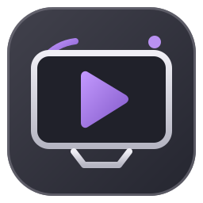

<h1 align="center">SynoStream</h1>

<strong>Your movies and TV shows, in one place.</strong> Open-source media library for Windows and Android, with Synology NAS support.

<a href="README.md">Magyar</a> · <a href="docs/INSTALL.md">Setup guide (HU)</a> · <a href="https://github.com/x10ilaci/SynoStream/issues/new/choose">Report an issue</a>

## Download

| Platform | Current version | Direct download |
|---|---|---|
| **Windows 10 / 11, 64-bit** | **1.109** | [Windows ZIP package](https://github.com/x10ilaci/SynoStream/releases/download/v1.109/SynoStream_1.109_Windows_x64.zip) · [Standalone EXE](https://github.com/x10ilaci/SynoStream/releases/download/v1.109/SynoStream_1.109.exe) |
| **Android 8.0+** | **0.5.27** | [Release APK](https://github.com/x10ilaci/SynoStream/releases/download/android-v0.5.27/SynoStream_Android_0.5.27.apk) |

Download the app package, not GitHub's **Code → Download ZIP** source archive. Running the Windows EXE does not require Python. Android updates require the system's installation confirmation.

## What it does

SynoStream turns your existing media files into a browsable movie and TV library with TMDB posters and descriptions. Windows supports local folders, network locations and Synology NAS sources. Android connects to your NAS and launches a video player installed on the phone.

- Poster library, search, sorting and season/episode organization.
- Metadata lookup from filenames, parent folders and NFO files, with manual corrections.
- Per-library TMDB recommendations that exclude recognized items already owned.
- Local network → DDNS/direct endpoint → QuickConnect routing for one configured NAS source.
- Background library updates that reuse existing metadata.
- Synology Download Station task management and torrent file selection.
- Separate Windows and Android update channels, with settings retained during upgrades.
- Hungarian and English UI.

See [screenshots](README.md#ízelítő-a-felületből), the [setup guide](docs/INSTALL.md) and [FAQ](docs/FAQ.md).

## Requirements and notes

NAS access uses File Station and an account with the necessary folder permissions. Torrent management additionally requires Download Station. Video Station is not required. TMDB metadata and recommendations require your own TMDB API key and internet access. Windows uses MPV for playback; Android uses an external video player.

The trash action deletes real NAS files after review and confirmation. The Windows EXE currently has no Authenticode signature. Android 0.5.27 is a non-debuggable release build; a release build does not guarantee Google Play Protect approval. See the [security and signing policy](CODE_SIGNING_POLICY.md).

## Contributing and license

[Contribution guide](CONTRIBUTING.md) · [Developer guide](docs/DEVELOPMENT.md) · [Security reports](SECURITY.md)

**GNU GPL-3.0-only** — [LICENSE](LICENSE). Maintained by [@x10ilaci](https://github.com/x10ilaci).

TMDB supplies metadata and the Android demo's poster images. *This product uses the TMDB API but is not endorsed or certified by TMDB.* SynoStream is an independent project, not an official Synology application.
