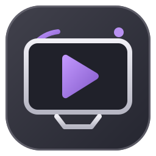
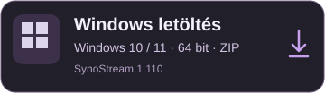
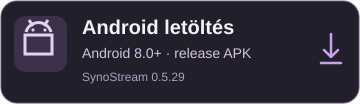
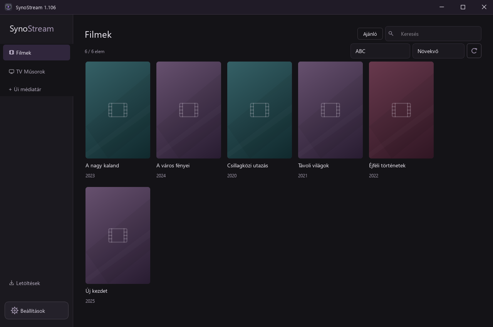
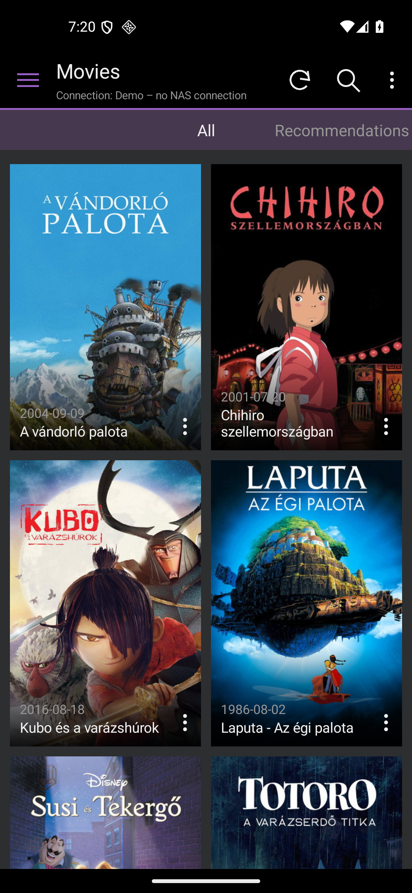

<h1 align="center">SynoStream</h1>

<strong>A saját filmjeid és sorozataid, egy helyen.</strong> Nyílt forrású médiatár és lejátszás Windowsra és Androidra, Synology NAS-támogatással.

<a href="README.en.md">English</a> · <a href="docs/INSTALL.md">Telepítés</a> · <a href="docs/FAQ.md">Gyakori kérdések</a> · <a href="https://github.com/x10ilaci/SynoStream/issues/new/choose">Hibajelentés</a>

## Letöltés

| Platform | Aktuális kiadás | Közvetlen letöltés | További fájlok |
|---|---|---|---|
| **Windows 10 / 11, 64 bit** | **1.108** | [Teljes ZIP-csomag](https://github.com/x10ilaci/SynoStream/releases/download/v1.108/SynoStream_1.108_Windows_x64.zip) · [Csak az EXE](https://github.com/x10ilaci/SynoStream/releases/download/v1.108/SynoStream_1.108.exe) | [Kiadási jegyzet és forrás](https://github.com/x10ilaci/SynoStream/releases/tag/v1.108) |
| **Android 8.0 vagy újabb** | **0.5.26** | [APK telepítő](https://github.com/x10ilaci/SynoStream/releases/download/android-v0.5.26/SynoStream_Android_0.5.26.apk) | [Kiadási jegyzet és forrás](https://github.com/x10ilaci/SynoStream/releases/tag/android-v0.5.26) |

A fenti linkek a kész programokra mutatnak; a GitHub **Code → Download ZIP** gombja a forráskódot tölti le.

Windowson csomagold ki a ZIP-et, és indítsd el az EXE-t. Androidon telepítsd az APK-t. Az alkalmazás használatához nincs szükség Pythonra, Java-fejlesztőkörnyezetre vagy GitHub-fiókra.

**Már használod?** Az alkalmazáson belüli frissítés megőrzi a beállításaidat. Androidon az új kiadás a meglévő fölé telepíthető; a rendszer telepítési jóváhagyást kér. [Frissítés és adatmegőrzés →](docs/INSTALL.md#frissítés)

## Mire való?

A SynoStream a már meglévő médiafájljaidból készít áttekinthető, plakátos film- és sorozattárat. A címeket, leírásokat és borítókat TMDB-adatokkal egészíti ki, rendszerezi az epizódokat, és elindítja a kiválasztott műsort.

**Windowson** helyi lemezekkel, hálózati mappákkal és Synology NAS-sal is használható. **Androidon** a Synology NAS-on tárolt médiatárat éred el; a lejátszáshoz a telefonon választott videólejátszót használja.

### Amit tud

- **Plakátos médiatár:** keresés, rendezés, filmek és sorozatévadok áttekinthető kezelése.
- **Médiainformációk:** TMDB-keresés fájlnév, mappanév és NFO alapján; kézi javítás, ha szükséges.
- **Ajánló médiatáranként:** új válogatások, a felismert saját tartalmak kizárásával.
- **Egy NAS, több elérés:** helyi hálózat → DDNS / közvetlen cím → QuickConnect; a médiaforrást egyszer adod hozzá.
- **Tartalomfrissítés:** új és eltávolított fájlok ellenőrzése, a meglévő médiainformációk újrahasználatával.
- **Download Station:** torrentek hozzáadása, letöltendő fájlok kiválasztása és a NAS-on futó feladatok vezérlése.
- **Saját médiatáradatok:** kézi címjavítások NAS-on tárolható párosításai, magyar és angol kezelőfelület.
- **Beépített alkalmazásfrissítés:** külön Windows- és Android-csatorna a GitHub Releases kiadásaiból.

## Ízelítő a felületből

<table><tr><th>Windows</th><th>Android</th></tr><tr><td></td><td></td></tr></table>

*A Windows-képen mesterséges bemutatóadatok és az alkalmazás plakátpótlékai láthatók; az Android-kép a NAS nélküli demóból készült. Személyes médiatárat vagy belépési adatot egyik sem tartalmaz.*

## Első lépések

1. **Töltsd le** a készülékedhez tartozó csomagot a fenti gombokkal.
2. **Kapcsold hozzá a médiatáradat.** Windowson válassz helyi mappát, vagy állítsd be a NAS-t; Androidon add meg a NAS elérését.
3. **Tallózd be a forrásmappát.** A plakátokhoz és leírásokhoz saját TMDB API-kulcsot adhatsz meg a Beállításokban.
4. **Válassz műsort és indítsd el.** Windowson az MPV, Androidon egy telepített videólejátszó végzi a lejátszást.

[Telepítési és NAS-beállítási útmutató →](docs/INSTALL.md)

## Tudnivalók

- A NAS-os használathoz File Station és megfelelő mappajogosultság szükséges; a torrentfunkciókhoz Download Station is kell.
- A TMDB-adatokhoz, ajánlásokhoz és frissítésekhez internetkapcsolat szükséges.
- A kukaikon valódi NAS-fájlokat töröl, jóváhagyott fájllista alapján. [Törlés és adatkezelés](docs/FAQ.md#törlés)
- A Windows EXE jelenleg Authenticode-aláírás nélküli. Az Android **0.5.26 nem hibakereshető release APK**; a Play Protect minősítése ettől külön áll. [Telepítési figyelmeztetések](docs/FAQ.md#telepítési-figyelmeztetések)

## Segítség és fejlesztés

[Hibajelentés](https://github.com/x10ilaci/SynoStream/issues/new/choose) · [Gyakori kérdések](docs/FAQ.md) · [Közreműködés](CONTRIBUTING.md) · [Fejlesztői útmutató](docs/DEVELOPMENT.md) · [Biztonsági bejelentés](SECURITY.md)

## Licenc és adatforrások

**GNU GPL-3.0-only** — a [teljes licenc](LICENSE), a [Windows-összetevők](BINARY_NOTICES.md) és az [Android-összetevők](android/NOTICE.md) külön is elérhetők. Karbantartó: [@x10ilaci](https://github.com/x10ilaci).

A médiaadatok és az Android-demó borítói a TMDB-ről származnak. *This product uses the TMDB API but is not endorsed or certified by TMDB.* A SynoStream független projekt, nem a Synology hivatalos alkalmazása.
